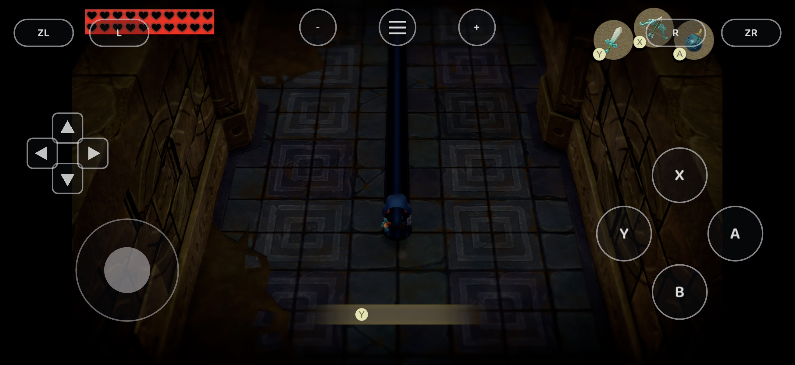
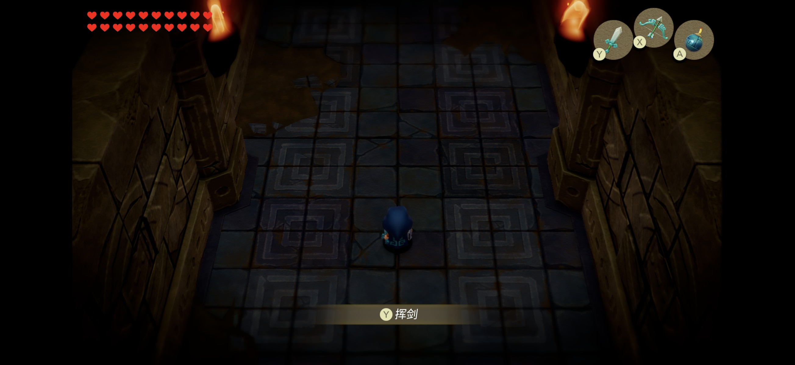

# Android Adreno validation

Validated on **Adreno 840 / Android 17 / Vulkan 1.4.295** using the supported v1.0.0 game build. A private Windows game library reproduced the renderer failures on **RTX 5060 Ti / Vulkan**. Shared Maxwell emitter changes were tested through Vulkan; **Metal was not tested**.

## Failures and fixes

| Symptom | Cause and resulting behavior |
| --- | --- |
| `VK_ERROR_FEATURE_NOT_PRESENT` during device creation | `uniformAndStorageBuffer8BitAccess` was requested although the renderer uses 32-bit uniform blocks. Removing this unused request allowed device creation. A device probe returned -8 before and 0 after. Initial Android surface creation also waits for an available native window. |
| Dark vertical strip from Link to the top of the room | `LDC.64 R6:R7,c[6][R6+40]` wrote R6 before calculating the second address. The fourth bone's Z translation was lost, stretching two four-weight meshes and contaminating depth/AO. Snapshot the overlapping address register before both loads. Normal shadows remain enabled. |
| Red rectangle behind the hearts | NVN RGB565 stores R in the low five bits. Vulkan PACK16 names fields from the high bits, requiring `B5G6R5_UNORM_PACK16`. Red/blue samples and the game's transparency decision are now correct. Other packed formats keep their preceding mappings. |
| Glyphs absent on the phone although icons render | Glyph vertex shaders fetch per-character storage data with LDG. The phone lacks `VK_EXT_external_memory_host`; the preceding path bound zeros. Read-only graphics loads now consult a per-draw/per-stage table and snapshot their valid bound NVN storage ranges, bounded by 32 MiB and the device's storage-buffer limit. This avoids copying the whole guest heap. Native import and compute copy-back remain available as before. |
| Chinese mode falls back to Japanese, or lacks glyphs | Serve modern `zh-Hans` / `zh-Hant`, accepting old `zh-CN` / `zh-TW` settings. Bundle an OFL-licensed static TrueType Noto Sans SC fallback, with source/hash/tool-version pins and the font license. Explicit fonts and console dumps retain precedence. A mutex prevents concurrent Address/Size requests from observing an unfinished font load. |
| Incompatible/damaged pipeline cache supplied to the driver | Bound disk-cache size and validate the native cache header, GPU identity and UUID before loading it. Keep atomic replacement on POSIX and include the shader optimization option in SPIR-V cache identity. |

The build changes use explicit bash for the game-library ID script, portable CMake SMAA embedding, and an optional NDK version override. The Python extractor also accepts common tickets/title.keys when reading the user's own rights-managed package.

The cache separation, packed-format/instruction investigation and pinned open-font conversion approach were informed by [S2Arm](https://github.com/jhaizhou-ops/S2Arm/tree/3fe7ea9d1df517cfc011667fcdc5818b79e2e226). No S2Arm renderer was integrated. The font is open Noto data, not a console font; see its [source and license](../third_party/fonts/NotoSansSC/README.md).

## Regression checks

The Vulkan tests use the production format mapper or Maxwell translator, shaderc, and actual GPU dispatch/sampling. The global-memory test translates **vertex-stage** instructions and observes them in a compute probe with no vertex inputs.

| Check | Observed result |
| --- | --- |
| `test_vk_ldc` | Before: `11111111 00000000`; after: `11111111 22222222`. |
| `test_vk_packed` | Before: red/green/blue sampled as blue/green/red; after: all three correct. |
| `test_vk_gmem` | Zero native heap previously returned zero; staged range returns `1234abcd`. Empty-map/native-heap control also returns `1234abcd`. |
| `test_pipeline_cache` | Valid native header accepted; truncation, oversize, version/GPU/UUID mismatch rejected. |
| `test_shared_fonts` | Original second request could observe size 0. Both threads now receive the same complete font. |
| `test_language` | Legacy/modern simplified/traditional codes, English and CRLF passed (six configurations). |
| `test_cjk_font.py` | 19 prompt/UI characters have real TrueType outlines; 30,890 mapped characters. Two pinned rebuilds produced identical font bytes. |

Example builds on a host with Vulkan/shaderc development libraries:

```sh
cc -O2 tools/test_vk_ldc.c runtime/nvn/maxwell/translate.c -lvulkan -lshaderc_shared -o build/test_vk_ldc
cc -O2 tools/test_vk_gmem.c runtime/nvn/maxwell/translate.c -lvulkan -lshaderc_shared -o build/test_vk_gmem
cc -O2 tools/test_vk_packed.c -lvulkan -lshaderc_shared -o build/test_vk_packed
cc -O2 tools/test_pipeline_cache.c -o build/test_pipeline_cache
cc -O2 -march=native -pthread -DEOW_RUNTIME tools/test_shared_fonts.c -o build/test_shared_fonts
cc -O2 -march=native -DEOW_RUNTIME tools/test_language.c -o build/test_language

build/test_vk_ldc
build/test_vk_gmem
build/test_vk_packed
build/test_pipeline_cache
build/test_shared_fonts third_party/fonts/NotoSansSC/EowSansSC-Regular.ttf
printf 'language = zh-CN\n' > build/test_language.ini
build/test_language build/test_language.ini zh-Hans
python tools/test_cjk_font.py
```

The executed Windows checks used LLVM-MinGW and the project's Windows compatibility header; Android compiled with NDK 28.1.13356709. The font builder requires `fonttools==4.67.0` and verifies its downloaded open-font sources before conversion.

## Device acceptance

The same-signature replacement APK loaded the original save. File-selection labels and the dungeon's **挥剑** prompt were readable, hearts had transparent surroundings, and the central strip disappeared after movement. Touch controls and background/foreground resume worked. All four save files were byte-identical to their pre-install backup. This is opening-scene/menu validation, not a full-playthrough or performance claim.

Before:



After:



## Remaining limitations

- Graphics snapshots are read-only; this does not implement general mobile GPU-write/compute fallback. SUST.P.B 2D RGBA stores are now supported on Vulkan; other unsupported instructions remain.
- Some Windows replay runs, including an original-font control, blocked in guest initialization. No fix for those waits is claimed. The documented full-scene no-import comparison completed before/after with a 3 ms pacing hook.
- No sustained FPS improvement, thermal result or Metal result is claimed.

## Prologue crash, movies and shader stores — 2026-11-12

The preceding installed build's retained log ended with `FATAL: no function at 1001a65870`.
The user's own supported main module contains an ADR followed by a BR seven instructions later;
the six-instruction classifier treated the case base as a callback and split the function.
The regenerated function now contains the missing case as an internal label. Integrate both
generator corrections from upstream [#22](https://github.com/Nycolazs/EoWRecomp/pull/22),
including its later 64-instruction window and distinction between integer and SIMD registers.
**An existing game library must be regenerated and rebuilt; replacing the runtime alone is insufficient.**

Selected fixes from #22 and [#23](https://github.com/Nycolazs/EoWRecomp/pull/23) also provide:

- FFmpeg reads directly from the packaged RomFS, with the extracted-directory fallback retained.
  Reopening an extractor clears packet/EOF/selection state; allocation failures and invalid/overflowing
  seeks return errors and release the custom IO buffer.
- SUST.P.B 2D RGBA image stores, storage descriptors and image views on Vulkan; bounded BRX
  compiler-table inspection, 32-lane warp operations inside wider subgroups, stencil texture views,
  and execution of NVN ClearBuffer. The earlier overlapping LDC.64 fix is retained.
- Present-interval pacing, periodic pipeline-cache saves and a polling/sleeping Android UI loop.
  The stock-driver graphics snapshots and Chinese font/language fixes remain in use.

The BRX optimization now requires the caller's actual compiler-constant size; unknown or short
constant regions retain the dispatch fallback. Reserved VOTE mode 3 returns a translation error
before indexing the three-expression array. The fuzz generator compares valid vote modes with
the older reference; a separate boundary test covers the reserved encoding.

The Android rebuild also exposed LLVM optimization blow-ups below the existing 3,000-instruction
dispatcher guard: an individual 2,807-instruction all-label function consumed over four minutes
of compiler CPU time. Android's `-O2` generation now applies the same existing `optnone` policy
above 1,500 instructions (desktop's guard remains unchanged). That function then compiled in
2.927 seconds on the same host. This changes the game-library ID and requires regenerating the
affected chunks. No claim is made about sustained gameplay performance after this build-time change.

| Validation | Result |
| --- | --- |
| `python3 tools/test_jump_tables.py` | Seven tests pass, including scheduled BR, FP register writes, control transfers and the scan limit. The previous classifier misses the scheduled-BR regression. |
| `test_translate_edges` with host AddressSanitizer/UndefinedBehaviorSanitizer | BRX constant bounds and reserved VOTE rejection pass; leak detection disabled for the sandbox's ptrace environment. |
| `test_movie_io` on Adreno 840 / Android 17 | The user's opening WebM yields the same 5,081 packets through image and file readers; reopen, seek, EOF and failure cleanup pass. No media is bundled. |
| `test_vk_sust` on stock Adreno 840 | The translated Maxwell program writes RGBA `64 128 191 255` into a Vulkan storage image, verified by GPU readback. |
| Existing `test_vk_ldc`, `test_vk_gmem`, `test_vk_packed` on that phone | Overlapping loads, both staged/native global-memory controls and all three RGB565 primaries pass. |
| 20,000 synthesized translator programs, reference `94cb4b0` | MSL: zero differences. GLSL: 14,259 compile and validate, zero compile/validation failures. Unsupported/random encodings are rejected (5,741 translations), not counted as successfully supported instructions. |
| Android native runtime | Builds with NDK 27.2.12479018; Vulkan tested, Metal not tested. |

The report of the post-rescue movie being skipped is **not yet a verified end-to-end fix**:
the retained game logs only open the title movie, even though all 19 WebMs exist on the phone.
The IO test verifies the opening resource, not the game's transition into it. Replay the rescue
with the regenerated library and inspect the new movie-open/decoder logs before claiming that
the scene plays correctly. No complete playthrough or sustained performance claim is made.

When the preceding APK's signing key is unavailable, use the separate application ID documented
in [BUILD-android.md](BUILD-android.md). Keep the original installation and test using a save copy.

### Rebuilt APK acceptance

The separate-ID personal APK loaded all four rebuilt modules (294,862 functions). Its title
movie opened directly from the packaged RomFS (69,188,808 bytes), with no extracted movie
directory in the test app. The Chinese file selector and the latest Zelda checkpoint loaded;
the live dungeon room rendered, with no fatal or shader-translation/pipeline failures in this
short run. Compute dispatches ran without the previous unsupported-SUST skips. A brief room
sample was approximately 24–26 fps at the copied resolution setting; this is not a 30 fps or
sustained-performance claim. The original 22 save files matched the backup before cleanup.

All three APK libraries (SDL, runtime and game code) passed 16 KiB LOAD-segment checks, the
APK passed 16 KiB ZIP alignment and signature verification, and the final installation started
without the previous compatibility dialog. This device acceptance does not replace replaying
the specific post-rescue cutscene; that transition remains unverified.
